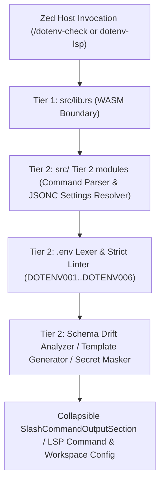

# Architecture Specification — zed-dotenv

> **Upstream Reference**: [mikestead/vscode-dotenv](https://github.com/mikestead/vscode-dotenv)  
> **Target Runtime**: Zed Editor Extension (Slash Command (`/dotenv-check`) + Language Server (`dotenv-lsp`)), compiled to WebAssembly (`wasm32-wasip2`, `zed_extension_api = "0.7.0"`).

---

## 1. Architectural Rationale: Translating `DotENV / Envellisense` to Zed

### 1.1 Runtime & Capability Delta

| Dimension | Upstream (`mikestead/vscode-dotenv`) | Target (`zed-dotenv`) | Architectural Impact |
|---|---|---|---|
| **Execution Host** | Node.js / VSCode Extension Host | WASI 0.2 sandbox (`wasm32-wasip2`) + Native `dotenv-lsp` / `dotenv-linter` subprocesses | WASM acts as a deterministic orchestrator, `.env` syntax linter, drift analyzer, and secret masker; editor-wide completion/diagnostics run via `dotenv-lsp`. |
| **User Interface** | VSCode Webviews, Hover Providers, Completion Providers | Slash Command (`/dotenv-check`) + Language Server (`dotenv-lsp`) | Interactive audit reports, `.env.example` drift tables, masked previews, and template generation in the Assistant panel (`SlashCommandOutputSection`), plus native LSP diagnostics/completions. |
| **Configuration** | `.vscode/settings.json` (`dotenv.*`) | `.zed/settings.json` (`lsp.dotenv-lsp.settings`) + automatic `.vscode/settings.json` JSONC import | Seamless migration from VSCode workspaces with Zed settings taking highest precedence. |
| **Dependency Policy** | Node `node_modules` tree | **Zero external crates** (`std` + `zed_extension_api` only) | Compact `.wasm` binary, instant host `cargo test` execution. |

---

## 2. End-to-End Execution Pipeline

### Stage Ordering Invariants:
1. **Pure Validation First**: JSONC settings normalization (`parse_dotenv_settings`) in the Tier 2 modules in `src/` execute before target `.env` processing.
2. **Host I/O Isolation**: `src/lib.rs` injects file-reading and `PATH` lookup closures (`which`) into Tier 2 helpers so the entire pipeline runs natively in host unit tests (`cargo test`).
3. **Secret Masking Guarantee**: All Assistant panel outputs (`render_audit_report`, `render_masked_preview`, `render_template_report`) pass variable values through `mask_value` or `<YOUR_KEY>` sanitization so raw secrets never appear in generated Markdown.
